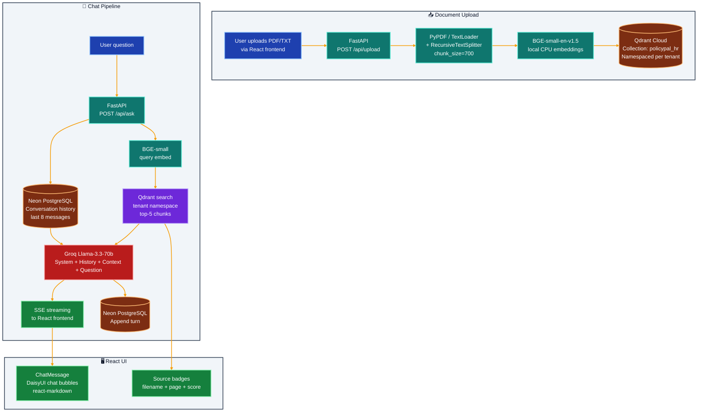

# PolicyPal — HR Policy AI Chatbot 📋

> Upload your HR and policy documents, ask questions in plain English, get precise answers grounded in your actual policies — with full conversation memory.

**Live demo:** [policypal.vercel.app](https://policypal.vercel.app) · **Backend:** [policypal-api.onrender.com](https://policypal-api.onrender.com)

---

## What It Does

PolicyPal is a **multi-tenant RAG chatbot** for company policies. Each "workspace" (tenant) has its own isolated vector namespace. The conversation history persists in PostgreSQL so context carries across sessions and page reloads.

- Upload PDF / TXT policy documents → indexed into Qdrant Cloud (namespaced by tenant)
- Ask natural-language questions → retrieved from the correct namespace
- Multi-turn conversation — previous Q&A is retrieved from Neon PostgreSQL and included in each prompt
- Groq Llama 3.3-70b generates grounded answers with source citations

## Outcome

- Enables reliable HR/policy self-service for employees
- Maintains tenant isolation for safer multi-company usage
- Preserves conversation continuity with persistent chat memory

---

## Architecture



---

## Tech Stack

| Layer | Technology | Cost |
|---|---|---|
| Frontend | React 18 + Vite + Tailwind + DaisyUI (corporate theme) | Free |
| Backend | FastAPI + Uvicorn | Free |
| Embeddings | BAAI/bge-small-en-v1.5 (local CPU) | Free |
| Vector DB | Qdrant Cloud — namespaced collections per tenant | Free |
| Conversation DB | Neon PostgreSQL (serverless, free tier) | Free |
| LLM | Groq Llama-3.3-70b-versatile | Free |
| File parsing | PyPDF + LangChain loaders | Free |
| Frontend hosting | Vercel | Free |
| Backend hosting | Render.com | Free |
| Python PM | UV (Astral) | Free |

**Total cost: $0**

---

## Project Structure

```
policypal-rag/
├── backend/
│   ├── app/
│   │   ├── api/routes.py        # POST /api/upload, /api/ask (SSE), GET /api/history, DELETE /api/history
│   │   ├── core/
│   │   │   ├── config.py        # Qdrant, Neon PostgreSQL, Groq settings
│   │   │   ├── database.py      # psycopg2 + Neon: conversation history CRUD
│   │   │   └── embeddings.py    # BGE-small singleton
│   │   ├── models/schemas.py    # AskRequest, UploadResponse, ChatMessage
│   │   ├── services/
│   │   │   ├── indexer.py       # PyPDF → chunks → Qdrant (tenant namespace)
│   │   │   ├── retrieval.py     # Qdrant vector search per tenant
│   │   │   └── llm.py           # Groq streaming with history
│   │   └── main.py
│   ├── pyproject.toml           # UV
│   ├── Dockerfile
│   └── .env.example
├── frontend/
│   ├── src/
│   │   ├── App.jsx              # Chat layout, tenant switcher, session ID
│   │   ├── components/
│   │   │   ├── ChatMessage.jsx  # DaisyUI chat bubbles + markdown
│   │   │   ├── ChatInput.jsx    # Textarea, Enter to send
│   │   │   └── UploadPanel.jsx  # File upload with progress
│   │   └── lib/api.js           # SSE stream handler, upload, history
│   └── package.json
└── docker-compose.yml
```

---

## Quick Start

### Prerequisites

- [UV](https://docs.astral.sh/uv/) installed
- [Node.js 20+](https://nodejs.org/)
- [Qdrant Cloud](https://cloud.qdrant.io/) free cluster
- [Neon](https://neon.tech/) free PostgreSQL project
- [Groq](https://console.groq.com/) API key

### 1. Backend

```bash
cd policypal-rag/backend
uv sync

cp .env.example .env
# Fill in QDRANT_URL, QDRANT_API_KEY, DATABASE_URL, GROQ_API_KEY

uv run uvicorn app.main:app --reload --port 8000
```

### 2. Frontend

```bash
cd policypal-rag/frontend
npm install
npm run dev
# → http://localhost:5173
```

### 3. Usage

1. Type a workspace name (e.g., `hr`) in the navbar input
2. Click "Upload & Index" in the sidebar to add policy PDFs
3. Ask questions in the chat — answers are grounded in your documents
4. Conversation history persists across sessions via the session ID stored in `localStorage`

---

## Environment Variables

| Variable | Description |
|---|---|
| `QDRANT_URL` | Qdrant Cloud cluster URL |
| `QDRANT_API_KEY` | Qdrant API key |
| `DATABASE_URL` | Neon PostgreSQL connection string |
| `GROQ_API_KEY` | Groq API key |
| `FRONTEND_ORIGIN` | CORS origin for production |

---

## Key Design Decisions

### Multi-Tenant Namespacing
Each tenant gets a separate Qdrant collection: `policypal_{tenant}`. This means:
- Complete data isolation — tenant A cannot retrieve tenant B's documents
- Independent scaling — large tenants don't affect small ones
- Simple deletion — `client.delete_collection("policypal_hr")` removes all HR data

### Conversation Memory
PostgreSQL (Neon) stores every message with `session_id`, `tenant`, `role`, and `content`. On each request, the last 8 messages are fetched and prepended to the Groq prompt. This enables:
- Follow-up questions ("What about for remote employees?")
- Reference to earlier answers
- Session continuity across page reloads

### SSE + History Write
The answer is assembled client-side token by token. The full assembled answer is only written to PostgreSQL after the stream closes (`onDone`). This avoids partial writes and ensures the stored conversation reflects exactly what the user saw.

---

## AI Engineering Concepts Demonstrated

- **Multi-tenant RAG:** isolated vector namespaces per customer/department
- **Conversation memory:** PostgreSQL-backed history with windowing (last N turns)
- **Stateless API + stateful DB:** backend is horizontally scalable; state lives in Neon
- **Streaming with side effects:** SSE stream + async DB write after completion
- **Input validation:** file type/size checks, tenant name sanitisation

---

## Logging

- Python logging is configured in backend app startup and controlled by `LOG_LEVEL`.
- Frontend API logging is controlled by `VITE_LOG_LEVEL`.
